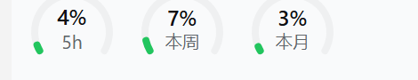

# OpenCode Go 用量表盘（DSH 插件）

在 DeepSeek Harness 的**左侧边栏底部**放三个 2/3 圆弧表盘（缺口朝下），分别显示 OpenCode Go 套餐的 **5 小时 / 本周 / 本月**已用百分比；圆弧按各自用量着色。悬停某个表盘看该窗口读数，点击任意表盘向上展开三窗口明细，并可一键打开 Console。

> A DSH client+host bundle that puts three OpenCode Go usage dials at the sidebar foot.



## 数据从哪来

| 项 | 说明 |
|---|---|
| 接口 | `GET https://opencode.ai/inference/go/v1/usage` |
| 鉴权 | `Authorization: Bearer oc_sk_...`，**密钥不随插件分发**：Host 侧每次读取时从 DSH 凭据库取 `OPENCODE_GO_API_KEY` |
| 返回 | `usage.rolling / weekly / monthly`，各含 `percent`（0–100）与 `resetsAt` |
| 计费影响 | 只读查询，不发 prompt，不消耗 Go 额度、不产生 token 计费 |

## 界面行为

- **位置**：注册在 `sidebar.footer.action` 席位（账号行上方），三个 **52px** 表盘并排：`5h` / `本周` / `本月`。
- **颜色**：各自独立按 `<70%` 绿、`70–89%` 黄、`≥90%` 或撞限额红。
- **字号**：数字 12px；标签 9.5px（`5h` 用 10.5px，补拉丁字符的视觉重量差）；`100%` 这类四字符读数自动降到 10.5px，避免贴到圆弧（52px 表盘内径约 38px）。
- **悬停**：Harness 风格气泡，显示对应窗口，例如 `本周 · 已用 6%`。
- **点击**：向上弹出共享面板，列出三个窗口（百分比胶囊 + 进度条 + 重置倒计时），底部 `打开 Console ↗`。
- **侧边栏折叠时**：表盘**直接隐藏**，没有窗口角落的兜底版本；侧边栏重新展开后回来。
- **刷新**：打开页面、切回前台、切换会话、每轮对话结束各读一次，另有 60 秒兜底；页面隐藏时不轮询。
- **无 key 时**：直接不显示；上游异常时表盘显示 `—`，恢复后自动回到正常读数。

## 安装

1. DSH → **插件** → **添加插件** → 选择这个目录（本地目录安装会以 link 方式接入）；或
2. 让 agent 用 `plugin_manager` 的 `install_bundle`，目标填这个目录的绝对路径。

安装后插件行 id 为 `deepseek-balance-badge`（历史命名，功能就是这套表盘），客户端模块 id 为 `@local/deepseek-balance-badge`。

## 配置（可选）

`cordis.patch.yml` 里可以钉住点击的目标页：

```yaml
- insert:
    - id: deepseek-balance-badge
      name: '@local/deepseek-balance-badge'
      config:
        # 你的工作区页面，organization 换成自己的
        consoleUrl: 'https://opencode.ai/console/<organisation>/go'
```

不配置时点击落到 `https://opencode.ai/console`。注意 `/console/go` 是**套餐介绍页**，`/console/<org>/go` 才是登录后的工作区 Go 页，`/console/<org>/activity` 是用量图表页。

其他可选字段（都有默认值）：`apiKeyEnv`（默认 `OPENCODE_GO_API_KEY`）、`timeoutMs`（默认 8000）。

## 架构

```
客户端（浏览器 / Electron 渲染进程）
  └ 侧栏三个表盘：只渲染，不持有密钥
         GET /plugin-api/opencode-go/usage   （同源，Host 侧 10 秒缓存）
  ▼
Host（Node）
  ├ 从 ctx.credentials 读 OPENCODE_GO_API_KEY
  ├ 请求 https://opencode.ai/inference/go/v1/usage
  └ 返回 { ok, usage, consoleUrl }
```

- 路由只接受 `GET/HEAD`，CORS 仅回显 `dsh-app://app` 与本机 loopback 来源。
- 气泡与面板用 `position: fixed`，位置由「钉在 `left:0;bottom:0` 的零尺寸探针」量出真实包含块原点，因此不受祖先 `transform` / containment 影响。
- 只有一条 HTTP 路由，没有工具、没有系统提示词注入、不写会话日志，不影响每轮 token。

## 文件

| 文件 | 作用 |
|---|---|
| `index.js` | Host：凭据读取 + 上游请求 + 缓存 + 路由 |
| `client.js` | Client：三个表盘、气泡、三窗口面板 |
| `cordis.patch.yml` | 插件行与可选配置 |
| `package.json` | bundle 与 client 声明 |
| `locale/*.json` | 插件列表里的中英文标题与说明 |
| `icon.svg` | 插件图标 |

## 脱敏说明

这个包里**不含**任何真实密钥、凭据文件或工作区 id：

- API key 从未写进代码；运行时从 DSH 凭据库按名字读取；
- `cordis.patch.yml` 中的工作区地址已替换为占位 `<organisation>`；
- 没有本地绝对路径、没有账号信息。

## 已知限制

- 表盘只反映用量百分比，具体额度金额与模型明细仍在 Console；
- 侧边栏折叠后不显示任何表盘（按需求不提供角落兜底）；
- 依赖 OpenCode 的用量接口，官方若改路径/字段需要同步调整（`index.js` 顶部两个常量）。

## 许可

自用插件，随附即用；用到的接口与文案归 OpenCode 所有。
